<div align="center">

# 红鸦 AI Skills

### 一个主题、一篇文章或一条视频，生成整篇小红书图文。

输入主题，或粘贴文章、视频链接，自动生成**发布标题、正文和整套图片**。

支持**普通图文创作、爆款图文复刻、商品带货图文**。参考热门笔记重新创作，也能结合自己的商品资料和素材生成内容；标题、正文、大纲和每页配图都可以继续修改。

**生成后，一键同步小红书、抖音、公众号、知乎等多平台。**

通过发布插件，将文案和图片自动填入你浏览器里的平台发布页面。你可以预览、修改，最后亲自点击发布。

也支持在 **Codex、Claude Code、WorkBuddy** 等 AI Agent 中通过 Skill 调用。

**[查看案例](#三种创作方式从输入到成品) ｜ [在线体验](https://hy.ithinkai.cn) ｜ [安装 Skill](#安装-skill)**

[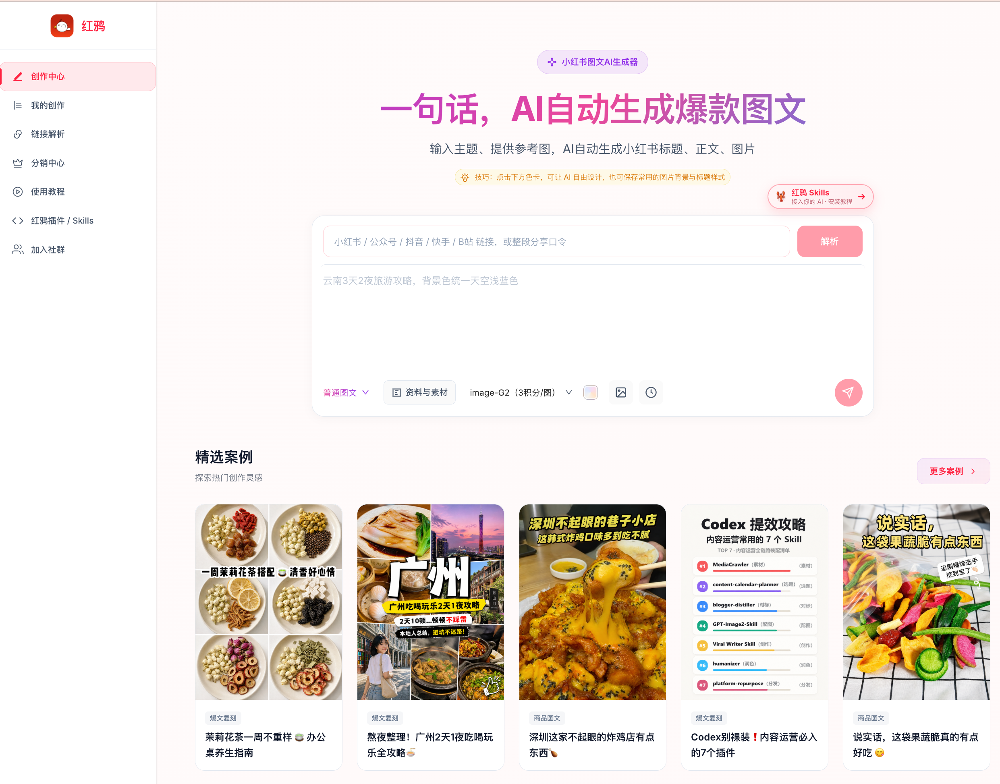](https://hy.ithinkai.cn)

</div>

## 三种创作方式，从输入到成品

| 普通图文 | 爆文复刻 | 商品图文 |
| --- | --- | --- |
| **输入主题 → 生成图文** | **输入链接 → 生成图文** | **输入主题 → 关联商品 → 生成带货图文** |
| 攻略、知识分享、教程、内容推广 | 逐页参考热门笔记，按自己的要求重新创作 | 结合商品资料、卖点和真实素材做内容 |
| [看普通图文案例 ↓](#案例一普通图文输入主题生成图文) | [看爆文复刻案例 ↓](#案例二爆文复刻输入链接生成图文) | [看商品图文案例 ↓](#案例三商品图文输入主题关联商品生成带货图文) |

以下案例展示红鸦网页端的实际创作流程。通过 Agent 使用的方式见后面的 [Skill、MCP 与 OpenAPI](#在-agent-中使用红鸦) 介绍。

### 案例一：普通图文，输入主题生成图文

**输入一个主题，选择「普通图文」，生成标题、正文和每页大纲，再生成整套图片。**

示例输入：

> 写一篇小红书图文笔记，主题：人均 1k3，云南 3 天 2 夜旅游攻略。

生成结果包含攻略标题、发布正文和 7 页配图，覆盖路线、目的地、预算与实用提示。页数可以根据具体创作要求调整。

| 封面 | 行程路线 | 预算页 |
| --- | --- | --- |
| 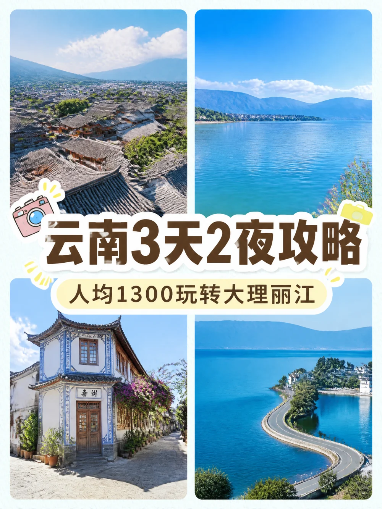 | 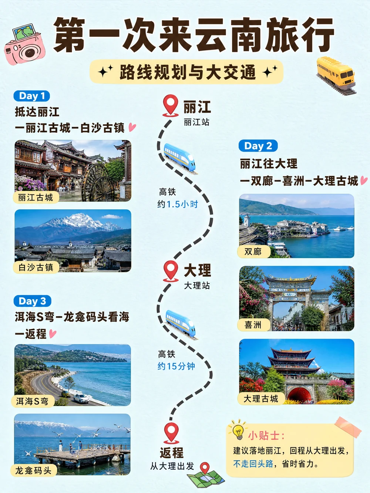 | 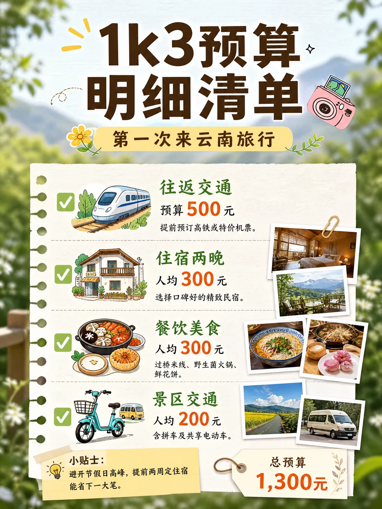 |

**[查看完整案例：输入、标题、正文与全部 7 张图片 →](docs/cases/normal.md)**

### 案例二：爆文复刻，输入链接生成图文

**粘贴小红书图文链接，选择「爆文复刻」，填写自己的要求，生成新的整篇图文。**

例如，参考一篇花茶笔记，提出要求：

> 参考原文的排版样式和图片风格，主题改为「石斛养生茶 6 种搭配」。

可以保留主题重新组织文案，也可以更换主题、内容与素材；想保留哪些版式、增加或减少哪些页，都可以在要求中说明。

| 花茶图文参考效果 | 更换主题后的石斛花茶图文 |
| --- | --- |
| 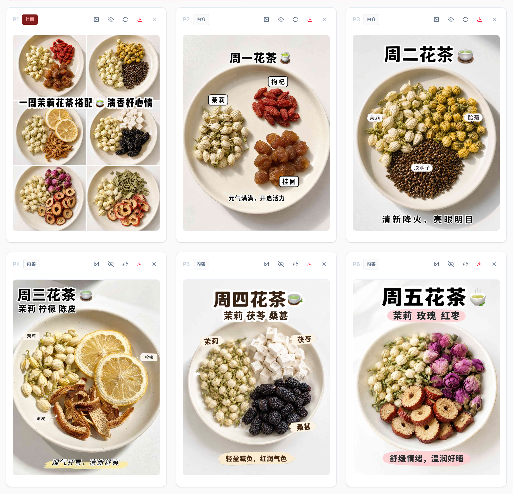 | 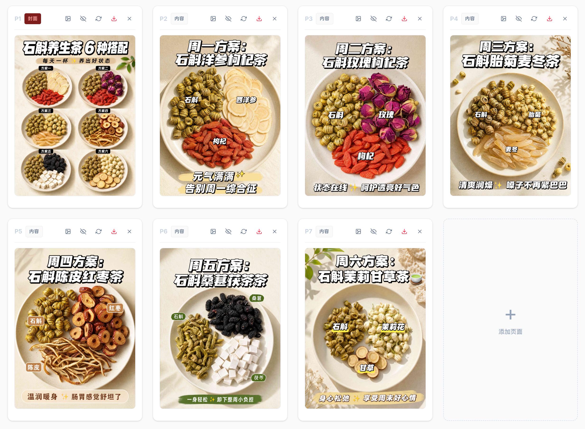 |

**[查看完整案例：原始链接、修改要求、文案与生成结果 →](docs/cases/viral-clone.md)**

### 案例三：商品图文，输入主题、关联商品，生成带货图文

**输入主题，选择「商品图文」，关联商品档案，再生成商品带货图文。**

示例输入：

> 写一篇果蔬脆片的种草图文，围绕办公室下午茶和追剧零食场景展开。

关联自己的果蔬脆片商品后，红鸦会结合商品资料、卖点和素材组织内容。先查看和修改文案、大纲，再生成每页配图。

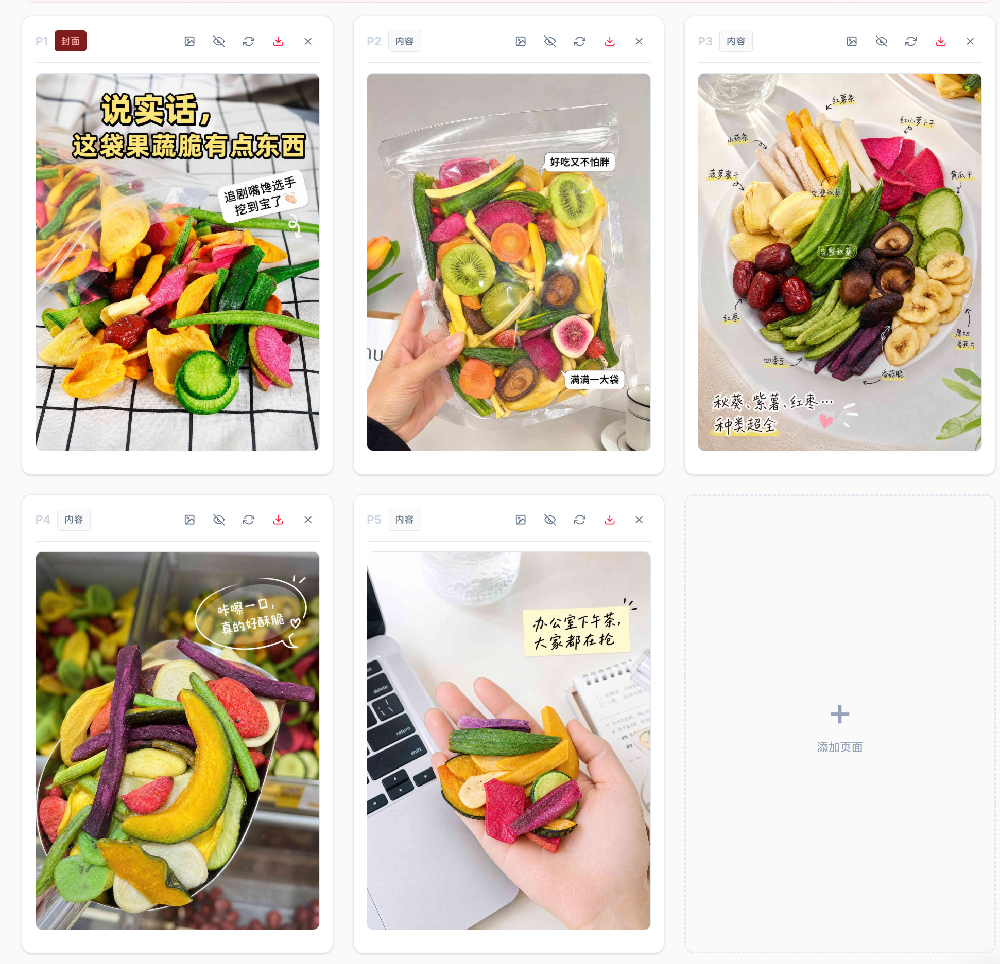

**[查看完整案例：输入主题、关联商品与生成结果 →](docs/cases/product.md)**

## 从资料到整篇图文，接着完成发布

**主题 / 文章 / 视频 → 选择创作方式 → 关联资料与素材 → 标题、正文和大纲 → 修改并生成图片 → 下载或同步发布**

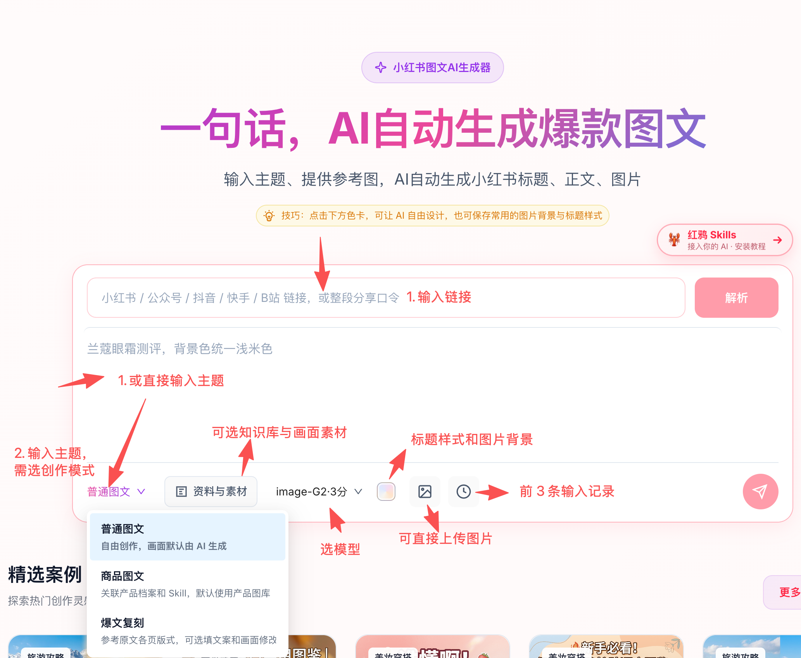

| 你要做的事 | 红鸦提供的功能 |
| --- | --- |
| 把已有内容变成图文 | 解析小红书图文、公众号文章或视频链接，整理为创作资料 |
| 复用自己的业务资料 | 关联知识库，使用品牌、课程、业务介绍等长期资料 |
| 围绕真实商品创作 | 关联商品档案，复用商品信息、卖点与商品图片 |
| 指定图片内容与布局 | 按页选择画面素材和版式参考，写明保留、替换与修改要求 |
| 控制整篇内容 | 编辑发布标题、正文、每页文案与画面要求，再生成图片 |
| 调整某一页 | 放大检查图片，修改单页要求并重新生成 |
| 交付与发布 | 单张或整套下载，通过发布插件同步到平台发布页面 |

**画面素材决定画面里使用什么；版式参考帮助指定怎样组织布局和视觉样式。**

<details>
<summary><strong>展开查看完整操作示例：解析、商品关联、大纲、批量生成与 Agent 调用</strong></summary>

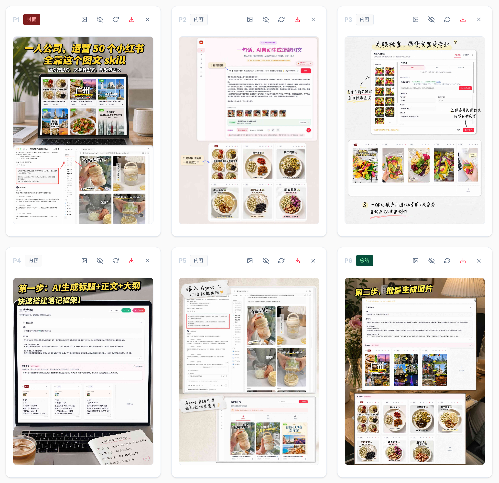

</details>

### 一键同步多平台，预览后自己点击发布

生成图文后，可以通过发布插件将**标题、正文和图片**同步到小红书、抖音、公众号、知乎等平台的浏览器发布页面。

文案和图片自动填入后，你仍然可以检查、修改，最后亲自点击发布。具体支持的平台和操作步骤以插件当前版本为准。

**[前往红鸦，查看发布插件与使用教程 →](https://hy.ithinkai.cn)**

## 在 Agent 中使用红鸦

给 Codex、Claude Code、WorkBuddy 等 Agent 安装红鸦 Skill，就可以在对话中提出需求、查看大纲、修改文案和生成图片。

> 帮我做一篇云南 3 天 2 夜的小红书攻略。先给我标题、正文和每页大纲，我确认后再生成配图。

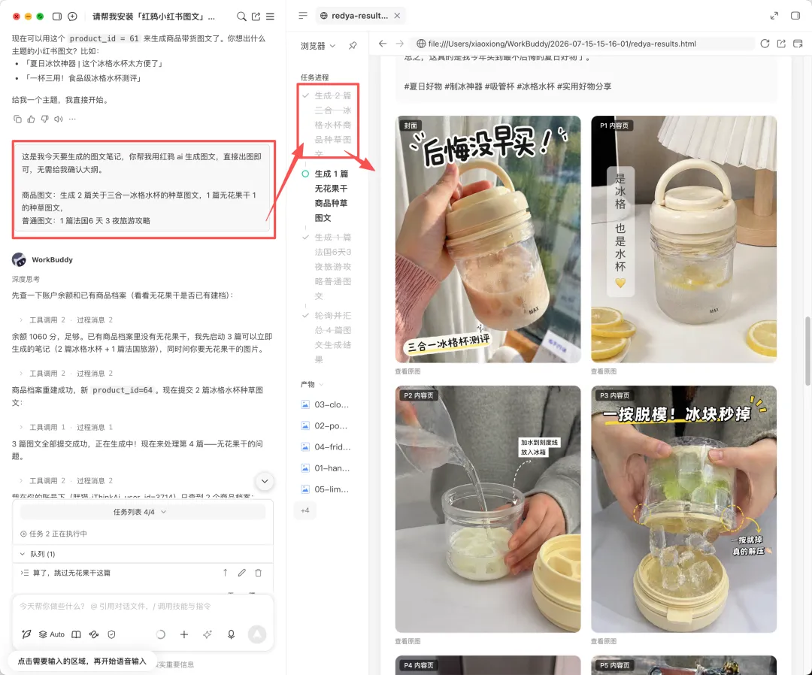

操作截图来自[红鸦完整工作流教程](https://mp.weixin.qq.com/s/7kIZOFyF13ySMdCJrLqsTQ)。

生成记录可以在同账号网页端「我的创作」中查看，继续预览、保存或下载。

<details>
<summary><strong>查看 Agent 与网页端「我的创作」的操作截图</strong></summary>

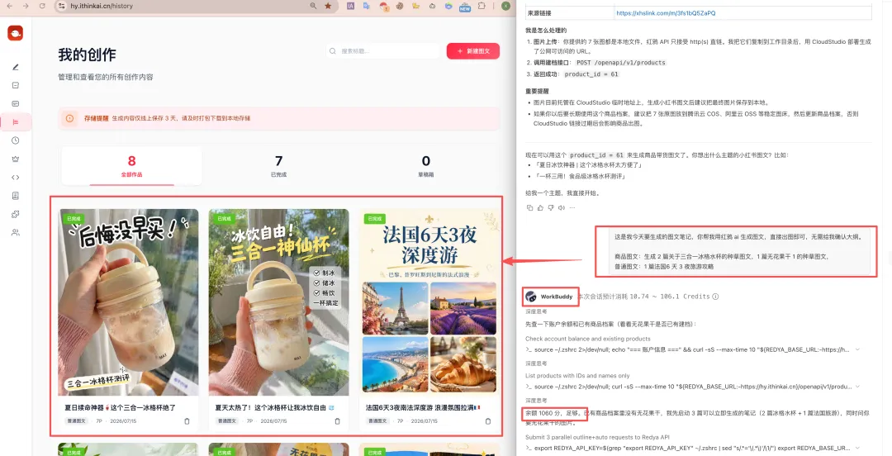

</details>

| 接入方式 | 用法 | 文档 |
| --- | --- | --- |
| **Skill** | 在 Agent 对话中生成大纲、修改内容、批量出图，创建或复用商品档案 | [Skill 说明](skill/redya-xiaohongshu/SKILL.md) |
| **MCP** | 通过支持 MCP 的客户端调用大纲、图片、商品和记录等工具 | [MCP 配置与工具清单](mcp/README.md) |
| **OpenAPI** | 把已开放的图文创作接口集成到自己的应用中 | [接口文档](docs/openapi-v1.md) |

各接入方式的功能以对应工具和接口文档为准；多平台同步通过发布插件完成。

## 安装 Skill

### 1. 获取自己的 API Key

打开 **[红鸦 AI](https://hy.ithinkai.cn)**，登录后进入「红鸦 Skills」，创建自己的 API Key。

### 2. 让 Agent 安装，或手动安装

可以把下面这段发给你的 Agent：

```text
请安装这个仓库里的 redya-xiaohongshu Skill：
https://github.com/rnthking/redya-skills

安装好后，帮我配置本地环境变量 REDYA_API_KEY 和 REDYA_BASE_URL。
REDYA_BASE_URL 使用 https://hy.ithinkai.cn。
```

<details>
<summary><strong>手动安装到 Codex</strong></summary>

```bash
mkdir -p ~/.codex/skills/redya-xiaohongshu
curl -fsSL https://raw.githubusercontent.com/rnthking/redya-skills/main/skill/redya-xiaohongshu/SKILL.md \
  -o ~/.codex/skills/redya-xiaohongshu/SKILL.md
export REDYA_API_KEY='rk-你的key'
export REDYA_BASE_URL='https://hy.ithinkai.cn'
```

</details>

<details>
<summary><strong>手动安装到 Claude Code</strong></summary>

```bash
mkdir -p ~/.claude/skills/redya-xiaohongshu
curl -fsSL https://raw.githubusercontent.com/rnthking/redya-skills/main/skill/redya-xiaohongshu/SKILL.md \
  -o ~/.claude/skills/redya-xiaohongshu/SKILL.md
export REDYA_API_KEY='rk-你的key'
export REDYA_BASE_URL='https://hy.ithinkai.cn'
```

</details>

其他 Agent 请将 [SKILL.md](skill/redya-xiaohongshu/SKILL.md) 放入其支持的技能目录。希望通过 MCP 接入的客户端可查看 [MCP 文档](mcp/README.md)。

### 3. 生成你的第一篇图文

> 帮我写一篇「办公室绿植推荐」的小红书图文。先给我看标题、正文和每页大纲，确认后再生成图片。

商品图文也可以直接说：

> 用我已有的商品档案，做一篇办公室零食种草图文，先给我看大纲。

## 更多生成效果

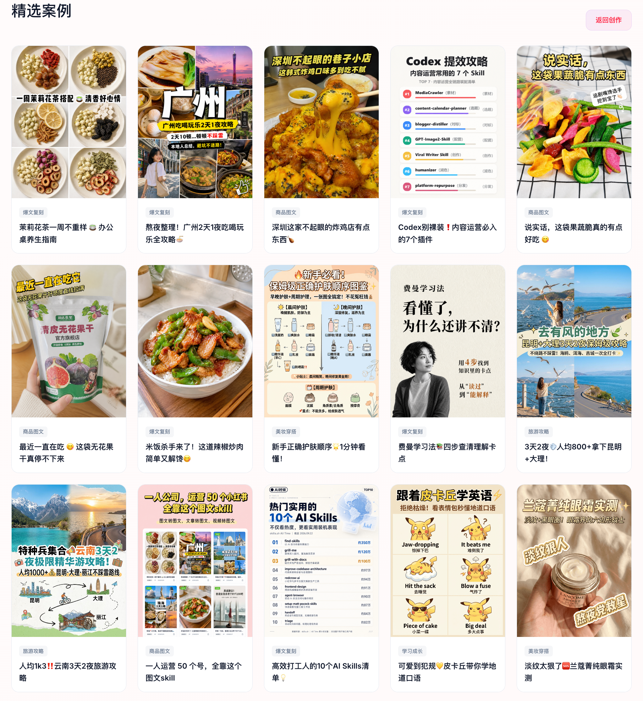

**[打开红鸦，查看精选案例 →](https://hy.ithinkai.cn)**

## 实操教程

- [从爆文链接解析、逐页复刻，到整套配图与发布](https://mp.weixin.qq.com/s/7kIZOFyF13ySMdCJrLqsTQ)
- [主题、文章与视频输入，知识库、商品档案和完整创作工作流](https://mp.weixin.qq.com/s/2W3WAa-2MaiD40cRTnUwDA)
- [普通图文、商品图文与 Agent 调用入门](https://mp.weixin.qq.com/s/yr8dFcwgrbf5a-z-g4Z35g)

## 常见问题

<details>
<summary><strong>会生成多少张图片？</strong></summary>

按具体创作要求和大纲确定，不固定为 9 张。可以在生成前说明页数，并修改每页内容。

</details>

<details>
<summary><strong>如何收费？</strong></summary>

调用使用绑定红鸦账号的积分。费用随创作内容、所选模型和操作变化，具体以当前网页说明及接口返回为准。

</details>

<details>
<summary><strong>图片需要保存到本地吗？</strong></summary>

生成完成后可单张或整套下载。线上保存期限以作品页面当前提示为准，建议及时下载留存。

</details>

<details>
<summary><strong>是不是生成后就直接发布了？</strong></summary>

生成完成后，通过发布插件同步到浏览器中的平台发布页面。用户可以预览、修改，最后自行点击发布。

</details>

---

<div align="center">

**红鸦 AI · 从内容创作，到多平台发布准备**

**[在线体验](https://hy.ithinkai.cn) ｜ [查看案例](#三种创作方式从输入到成品) ｜ [安装 Skill](#安装-skill)**

广州灵境之城科技有限公司

</div>
