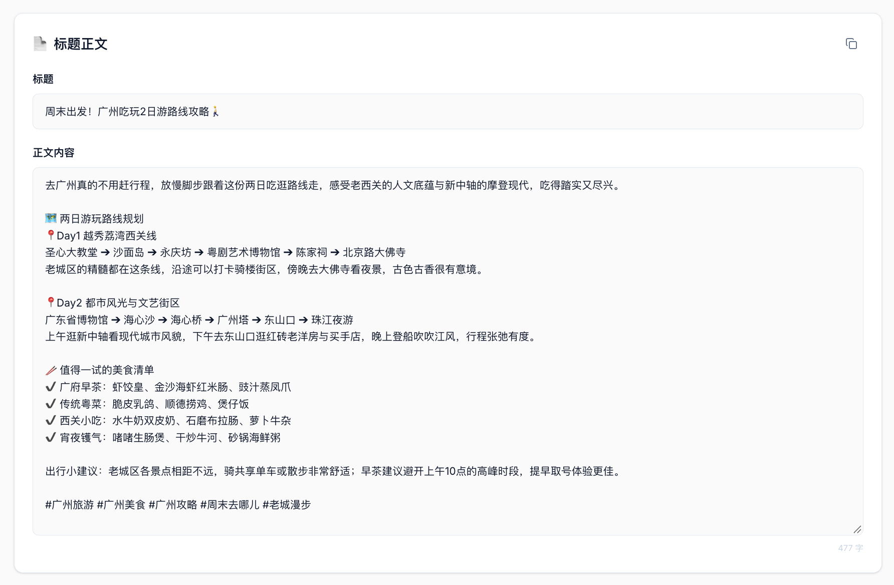
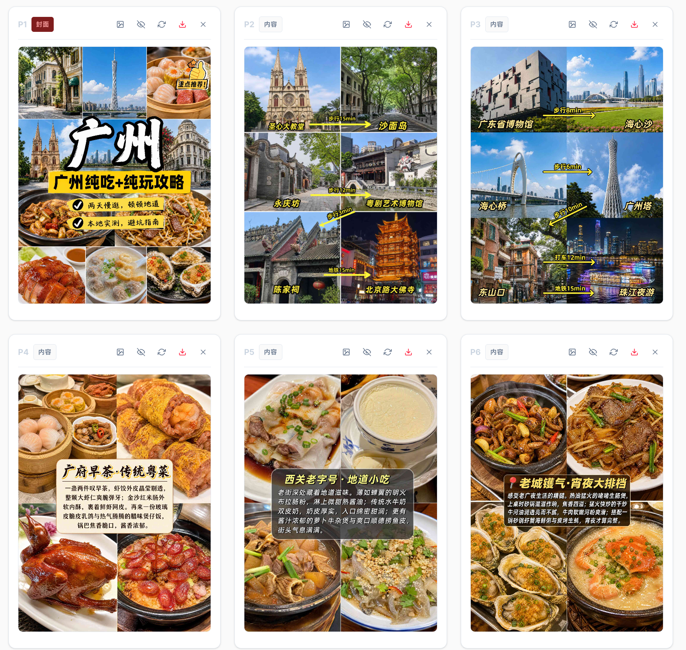
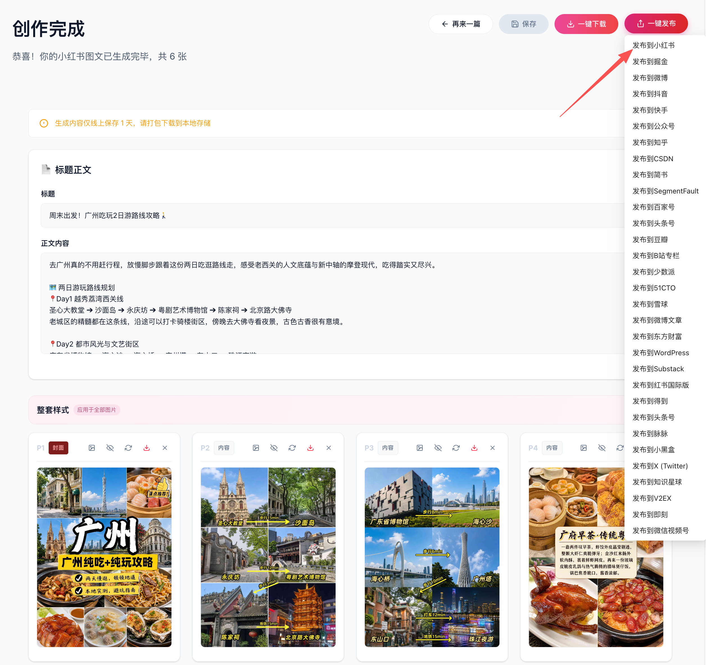
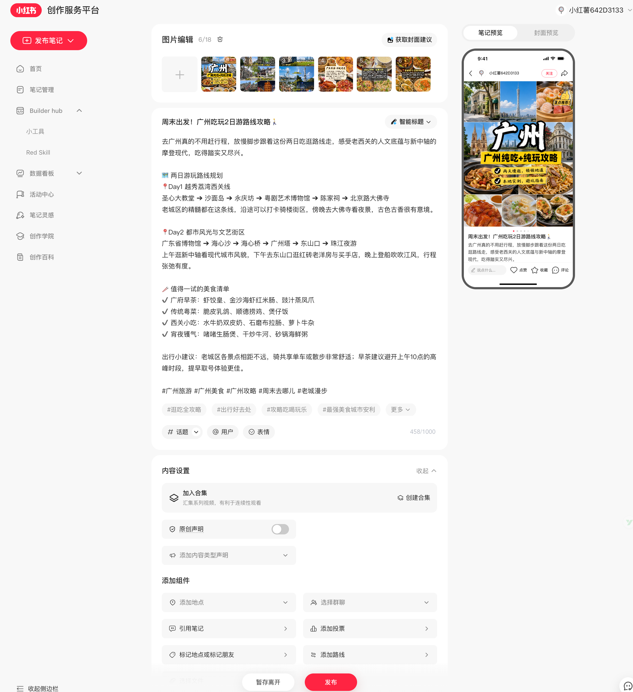

# 普通图文：输入主题，生成广州2日游攻略

[返回首页](../../README.md#案例一普通图文输入主题生成图文)

## 1. 输入主题

普通图文可以直接输入一个主题。主题写法示例：

```text
生成广州2日游攻略，包含两日游玩路线、美食清单和实用建议。
```

选择「普通图文」，先生成标题、正文和每页大纲，查看或修改后，再批量生成图片。

下面用这篇广州攻略展示文案、整套配图和发布页面的效果。

## 2. 生成的标题与正文

**周末出发！广州吃玩2日游路线攻略 🚶**

去广州真的不用赶行程，放慢脚步跟着这份两日吃逛路线走，感受老西关的人文底蕴与新中轴的摩登现代，吃得踏实又尽兴。

🗺️ 两日游玩路线规划

📍Day1 越秀荔湾西关线

圣心大教堂 ➜ 沙面岛 ➜ 永庆坊 ➜ 粤剧艺术博物馆 ➜ 陈家祠 ➜ 北京路大佛寺

老城区的精髓都在这条线，沿途可以打卡骑楼街区，傍晚去大佛寺看夜景，古色古香很有意境。

📍Day2 都市风光与文艺街区

广东省博物馆 ➜ 海心沙 ➜ 海心桥 ➜ 广州塔 ➜ 东山口 ➜ 珠江夜游

上午逛新中轴看现代城市风貌，下午去东山口逛红砖老洋房与买手店，晚上登船吹江风，行程张弛有度。

🥢 值得一试的美食清单

✔️ 广府早茶：虾饺皇、金沙海虾红米肠、豉汁蒸凤爪

✔️ 传统粤菜：脆皮乳鸽、顺德捞鸡、煲仔饭

✔️ 西关小吃：水牛奶双皮奶、石磨布拉肠、萝卜牛杂

✔️ 宵夜镬气：啫啫生肠煲、干炒牛河、砂锅海鲜粥

出行小建议：老城区各景点相距不远，骑共享单车或散步非常舒适；早茶建议避开上午10点的高峰时段，提早取号体验更佳。

#广州旅游 #广州美食 #广州攻略 #周末去哪儿 #老城漫步



## 3. 整套配图

共 6 张图片：封面、第一天路线、第二天路线、早茶粤菜、西关小吃和宵夜美食。



## 4. 同步到浏览器发布页

生成完成后，从发布入口选择要同步的平台。



标题、正文和 6 张图片同步到小红书发布页面后，可以继续预览、修改，最后自行点击发布。



## 带参考链接的输入示例

提供的这张实际输入截图还展示了另一种用法：解析一篇珠海攻略链接，并填写「参考原图风格，生成广州2日游攻略」。截图中的创作模式为「爆文复刻」。

它展示的是带参考内容的输入方式；上方的普通图文主题写法是单独给出的输入示例。


[回到红鸦开始创作](https://hy.ithinkai.cn)
