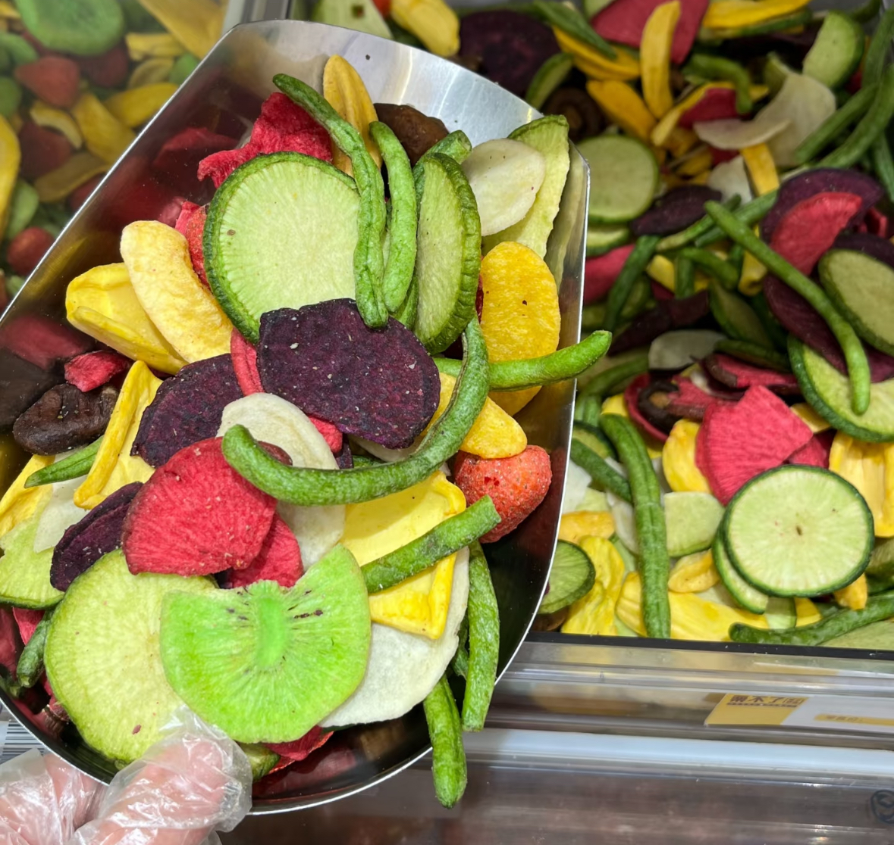

# 

[返回首页](../../README.md#case-product)

## 输入主题

```text
写一篇关于果蔬脆片的种草图文，围绕办公室下午茶和追剧零食场景展开。
```

这是用于演示操作方式的输入示例。

## 关联商品

选择「商品图文」，关联自己的果蔬脆片商品档案。商品资料包括名称、卖点和素材图片，后续创作可以继续复用。



关联商品后，生成标题、正文和逐页大纲；可以修改文案与每页使用的素材，再批量生成配图。

## 生成带货图文

下面是果蔬脆片图文的 5 页真实演示结果，展示封面、包装、种类、口感和办公场景。


## 商品档案和素材如何进入流程

下方操作图包含商品关联、标题正文与大纲编辑、批量生图、Agent 调用等完整步骤。


[回到红鸦开始创作](https://hy.ithinkai.cn)
