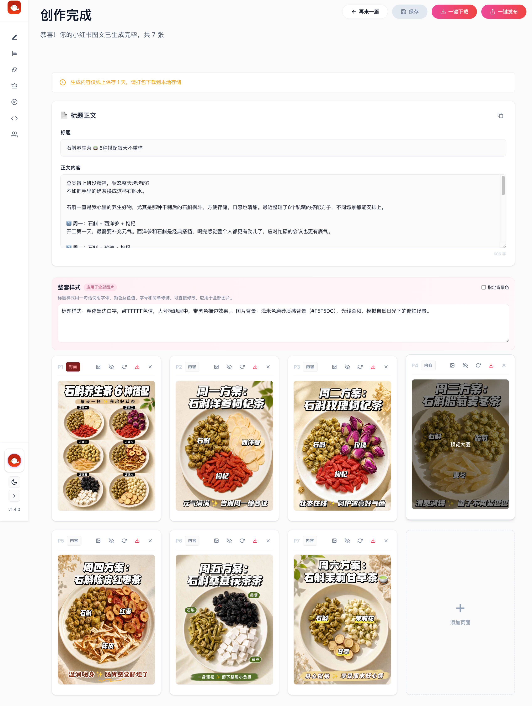

# 爆文复刻：输入链接，生成新的整篇图文

[返回首页](../../README.md#案例二爆文复刻输入链接生成图文)

## 输入链接和要求

- 粘贴一篇小红书花茶图文链接作为创作起点。
- 选择「爆文复刻」，解析原笔记。
- 填写要求，再查看和修改标题、正文及每页大纲。

示例要求：

```text
参考原文的排版样式和图片风格，主题改为：石斛养生茶 6 种搭配。
```

## 参考图文与生成结果

| 花茶参考效果 | 更换主题后的新图文 |
| --- | --- |
|  |  |

上图展示相同内容类型的版式参考与更换主题后的生成效果；图片可点击放大。

## 标题、正文与图片在同一篇作品中

生成结果页可以继续编辑标题、正文和每页图片要求，也可以下载整套图片。



## 怎样控制复刻方向

- 保留原主题，用自己的表达重新组织内容。
- 换成新主题，参考原文的视觉风格和信息结构。
- 在要求中说明页数、哪些元素保留、哪些内容替换。
- 按页绑定画面素材和版式参考，继续修改单页结果。

[回到红鸦开始创作](https://hy.ithinkai.cn)
