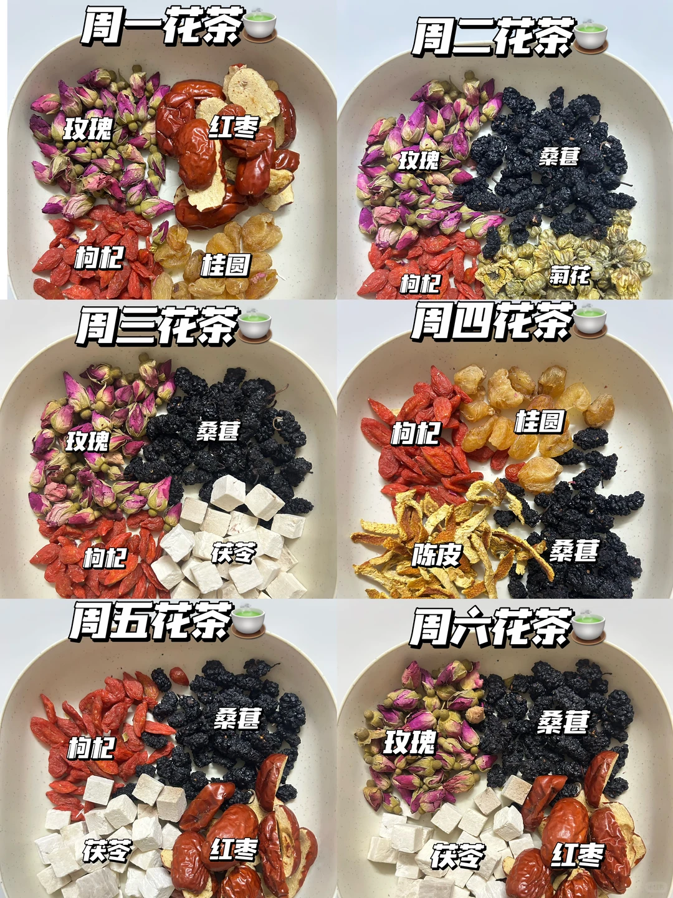
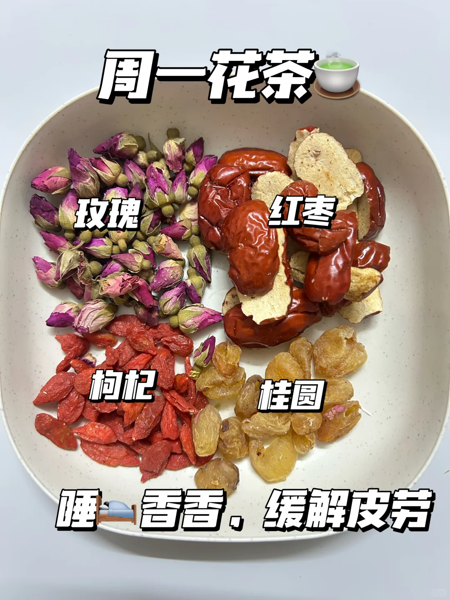
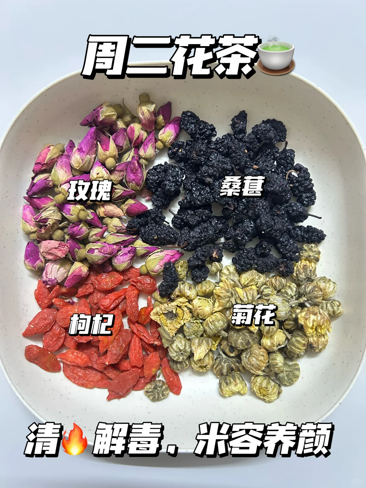
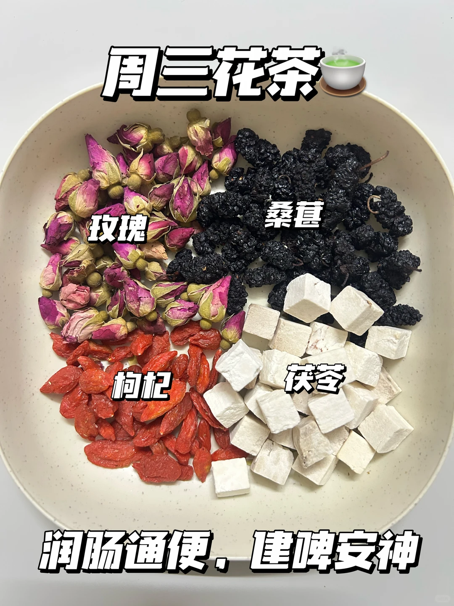
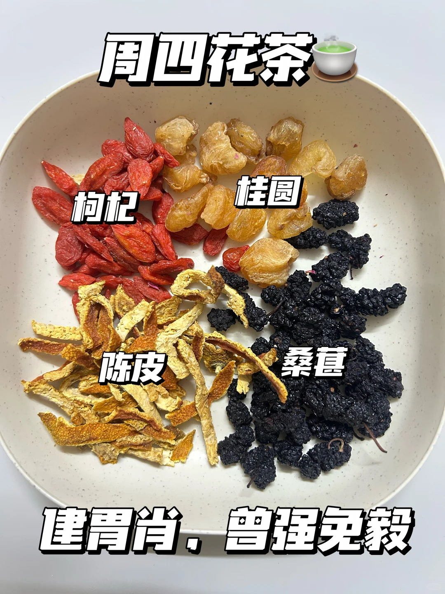
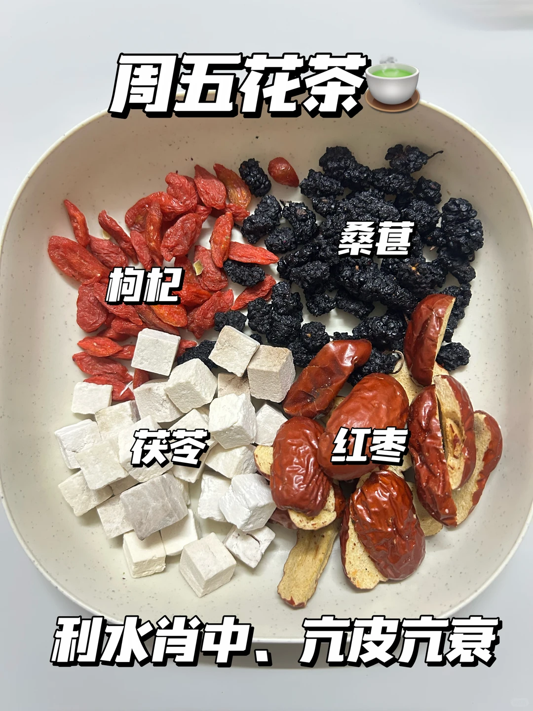
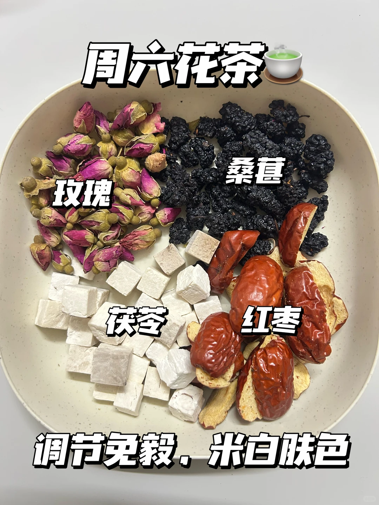
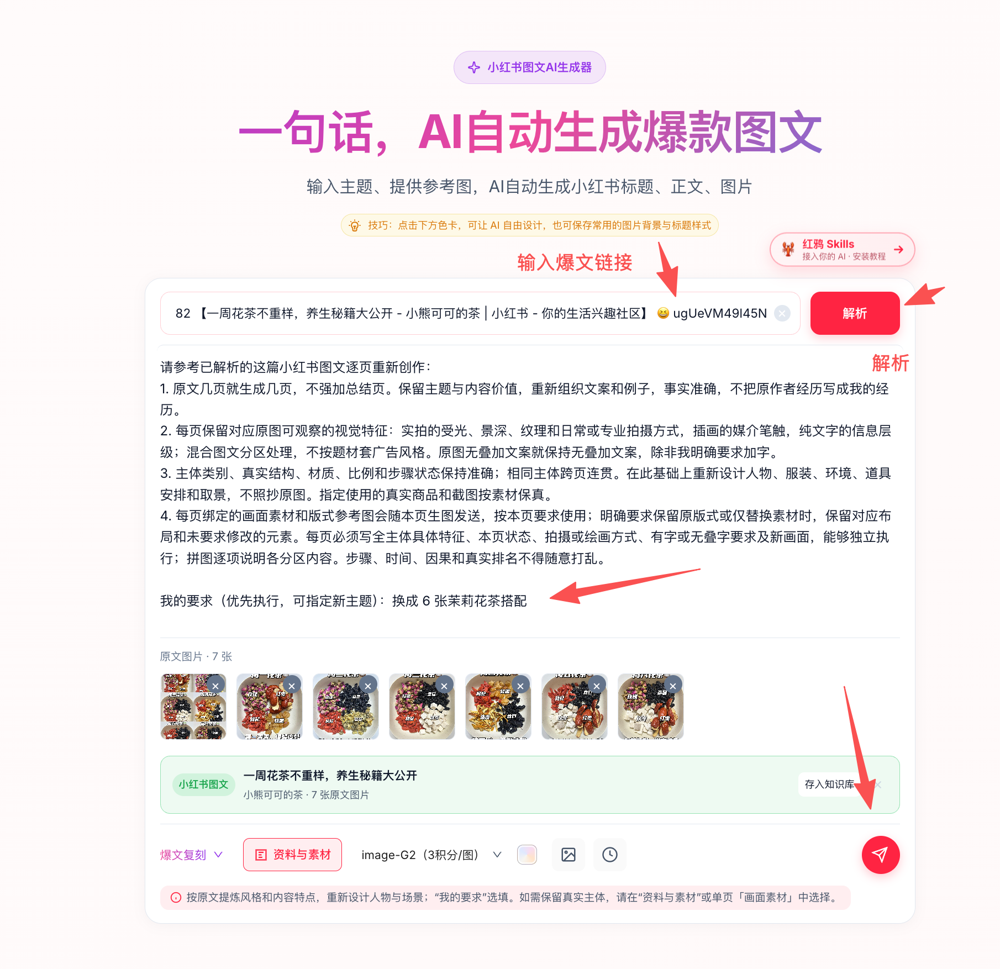
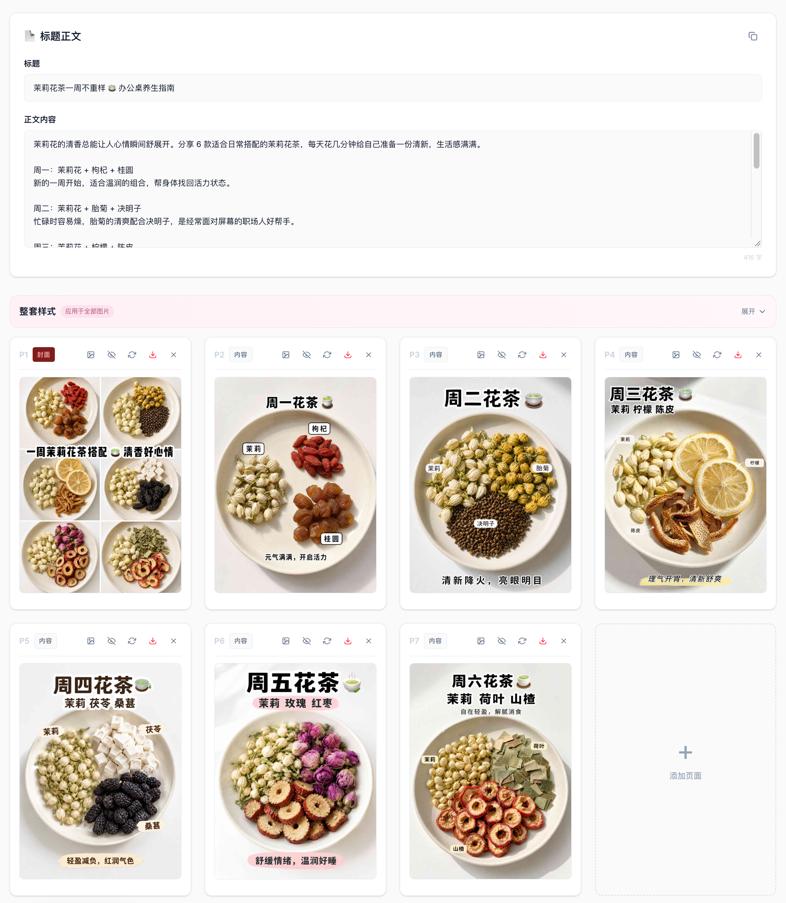

# 爆文复刻：输入链接，把一周花茶图文改写成茉莉花茶图文

[返回首页](../../README.md#案例二爆文复刻输入链接生成图文)

## 1. 原文是什么

原文：[一周花茶不重样，养生秘籍大公开](https://www.xiaohongshu.com/explore/69226a61000000001e02b203)，作者为「小熊可可的茶」。

原文共有 7 张图片：一张六格搭配封面，以及周一至周六的六张内容页。



<details>
<summary><strong>展开查看原文的 6 张内容页</strong></summary>

| 周一 | 周二 | 周三 |
| --- | --- | --- |
|  |  |  |

| 周四 | 周五 | 周六 |
| --- | --- | --- |
|  |  |  |

</details>

## 2. 怎样输入

粘贴原文的小红书链接，点击「解析」，选择「爆文复刻」。解析完成后，系统展示原文标题和 7 张原图。

在「我的要求」里填写：

```text
换成6张茉莉花茶搭配
```



## 3. 生成了什么

先生成新的标题、正文和每页大纲，查看或修改后，再批量生成图片。

生成标题：**茉莉花茶一周不重样 🍵 办公桌养生指南**。

| 原文封面 | 生成的茉莉花茶图文 |
| --- | --- |
|  |  |

下面的生成结果页展示标题、正文编辑区和配图：



## 4. 还可以继续改什么

- 修改发布标题、正文和每页文案。
- 调整大纲、页面数量、画面素材和版式参考。
- 修改某一页要求后重新生成图片。
- 下载图片，或通过发布插件同步到平台编辑页，检查后自行发布。

[回到红鸦开始创作](https://hy.ithinkai.cn)
